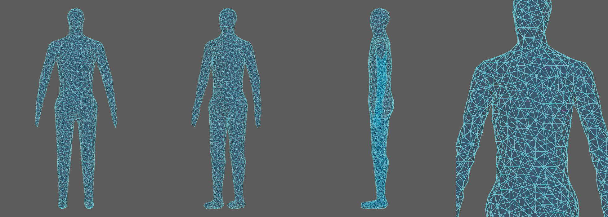
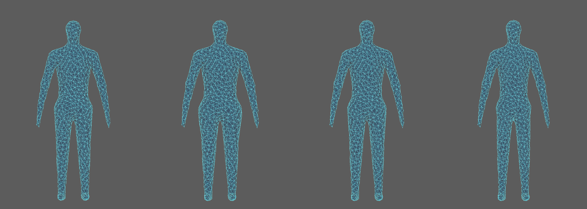

# A6: Wire Body Profile (InBody Data Build)

A blue wire-frame human figure in Maya, plus a **Wire Body Profile** window. You type in a set of body-composition measurements (the same list as an InBody printout), save them under a person's name and a date, and come back later to add more dated entries. A slider then reshapes the wire body across the saved entries, so you can watch the changes over time.



## Which app

**Autodesk Maya 2027** (tested on macOS). The tool is a Python script that runs inside Maya; nothing else needs to be installed.

The scene file was saved in Maya 2027, so older versions of Maya can't open it.

## Install

1. Download this repo: click the green **Code** button, then **Download ZIP**, and unzip it. Or clone it:
   ```
   git clone https://github.com/bshultz-sva/A6.git
   ```
2. Keep the files together. `InBody Data Build.mb` and the `wire_body` folder must stay side by side, because the scene looks for the code in the `wire_body` folder next to it.

## Run

1. Open Maya 2027.
2. **File > Open Scene...** and choose `InBody Data Build.mb`.
3. The **Wire Body Profile** window opens by itself once the scene has loaded.

If Maya asks whether to allow the scripts in the scene to run, say yes. That script is what opens the window. If you said no, or the window doesn't appear, open it by hand: go to **Windows > General Editors > Script Editor**, click the **Python** tab, paste this, change the path to where you put the repo, and press Ctrl+Enter (or Cmd+Enter):

```python
import sys
sys.path.insert(0, "/path/to/A6/wire_body")
import body_profile_ui
body_profile_ui.show()
```

## Using the window

- **Profile:** pick a saved person from **Saved profiles**, or choose **New profile...** and type a **Name**. The **Date** is filled in as today (YYYY-MM-DD).
- **Measurements:** fill in height and any of the measurements (weight, body fat mass, skeletal muscle mass, the lean mass of each arm, leg and the trunk, and so on). Blank fields are fine.
- **Save Entry** stores the entry. **New Entry** clears the form for another date.
- **History:** click an entry to load it back into the form. **Delete Selected Entry** removes it. The line under the list shows the change since the first entry.
- **Wire body over time:** the **Entry** slider goes from 0 (the neutral body) through each saved entry in date order, and the figure's height and the thickness of its trunk, arms and legs follow the numbers. **Exaggerate change** multiplies the differences between entries (4x by default), because real changes between weigh-ins are too small to see.
- **Rebuild Wire Body** builds the figure again from scratch if it was deleted or broken.



Profiles are saved as one JSON file per person in `~/Documents/wire_body/profiles` (the folder is created the first time you save). They stay on your own computer, not in this repo.

The way measurements turn into a body shape is a rough artistic model, not a medical one. The numbers it uses are at the top of `body_profile_ui.py`.

## Files

| File | What it is |
| --- | --- |
| `InBody Data Build.mb` | The Maya scene with the wire body, set to open the window on load |
| `wire_body/body_profile_ui.py` | The Wire Body Profile window |
| `wire_body/build_wire_body.py` | Builds the wire body in the open scene from `body_lowpoly.obj` (used by **Rebuild Wire Body**) |
| `wire_body/body_lowpoly.obj`, `body_highres.obj` | The body shape the wire frame is made from |
| `wire_body/make_body_shape.py` | Optional: sculpts the body shape and rewrites the two .obj files. Runs outside Maya and needs `pip install numpy scipy scikit-image`. You only need it to change the base body. |
